<div align="center">

# 🛣️ MobileRoad

### From app idea to production.

**An AI-assisted roadmap and project tracker that guides non-technical people through building, testing, publishing and maintaining a mobile app.**


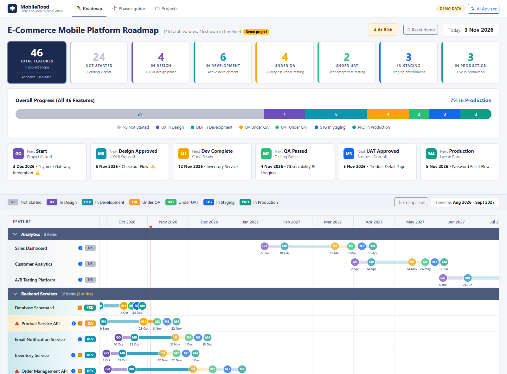

<sub>The demo project that ships with the app. Everything on screen is computed from real project data.</sub>

</div>

---

## Table of contents

- [The idea](#the-idea)
- [How it works](#how-it-works)
- [Feature tour](#feature-tour)
- [How progress and status are modeled](#how-progress-and-status-are-modeled)
- [Quick start](#quick-start)
- [Configure Gemini (optional)](#configure-gemini-optional)
- [Your data and backups](#your-data-and-backups)
- [Deploy: GitHub and Vercel](#deploy-github-and-vercel)
- [Architecture](#architecture)
- [Scripts and testing](#scripts-and-testing)
- [Known limitations](#known-limitations)
- [Ideas for later](#ideas-for-later)

---

## The idea

Most first-time app owners have a business idea and a budget, but no map of what happens between
*"I want an app"* and *"it is live in the App Store and Google Play"*. They hear words like CI/CD,
UAT or staging and cannot tell whether the project is on track.

**MobileRoad is the experienced technical project manager they do not have.** You describe the idea
(or upload a requirements document) and it produces a complete roadmap, explains every phase in plain
language, and then keeps score as work moves forward.

One principle drives the design:

> **The AI recommends, plans and explains. The application owns the facts.**
> Project state, progress, checkpoint completion, dependencies, status transitions, validation and
> persistence are deterministic TypeScript with unit tests. The AI never decides what is "done", and it
> never changes your roadmap without you confirming it.

The result still works with no API key: an offline mock answers from your project data, clearly labelled.

## How it works

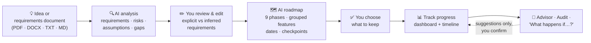

1. **Describe** your project with a guided form, or upload a document. Unreadable files are explained, never silently dropped.
2. **Review the analysis.** Each requirement is marked *explicit* (stated by you) or *inferred* (suggested), and missing information is listed as questions instead of being invented.
3. **Review the roadmap.** Phases, features and estimates are shown before anything is created; untick what you do not want.
4. **Track.** Move features through the lifecycle, complete checkpoints and watch every number update.
5. **Ask for help.** The advisor answers using your actual project, the audit flags gaps, and scope-change analysis shows impact before you accept any of it.

The lifecycle every roadmap covers:

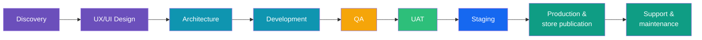

## Feature tour

### Progress at a glance

Eight KPI cards, a segmented progress bar and six milestone cards, all derived from the data. Click a
KPI card to filter the timeline by status.

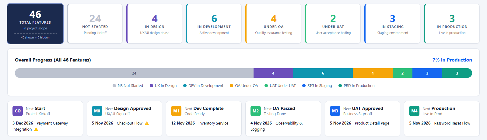

### A timeline you can work with

Monthly columns, expandable feature groups, a today marker, and the six milestone markers
(`GO` kickoff → `M0` design → `M1` dev → `M2` QA → `M3` UAT → `M4` production) on every feature.
Warning icons show risk, the blue icon shows dependencies and the orange arrow marks high priority.

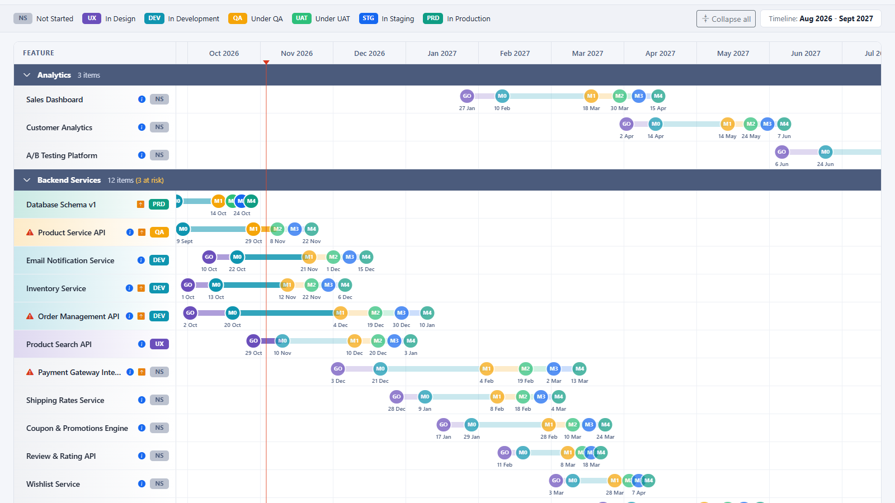

### Feature details

Click any feature to change its status, tick checkpoints (with acceptance criteria), edit dates, priority,
notes and dependencies, and ask the AI for recommendations. Invalid changes are rejected with a clear reason.

<p align="center">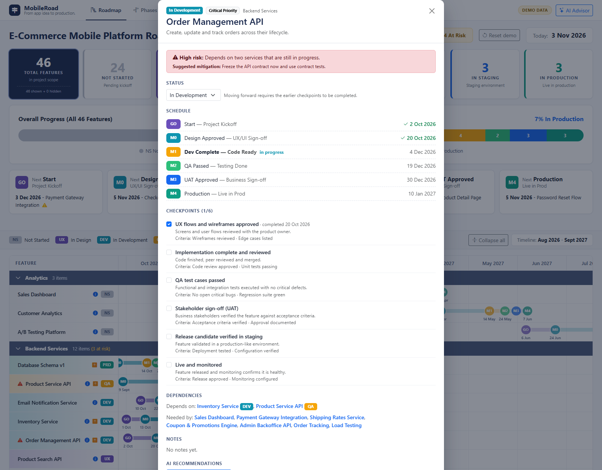</p>

### Create a project from an idea or a document

The wizard turns text into an editable analysis, then a roadmap you review before creating the project.

<p align="center">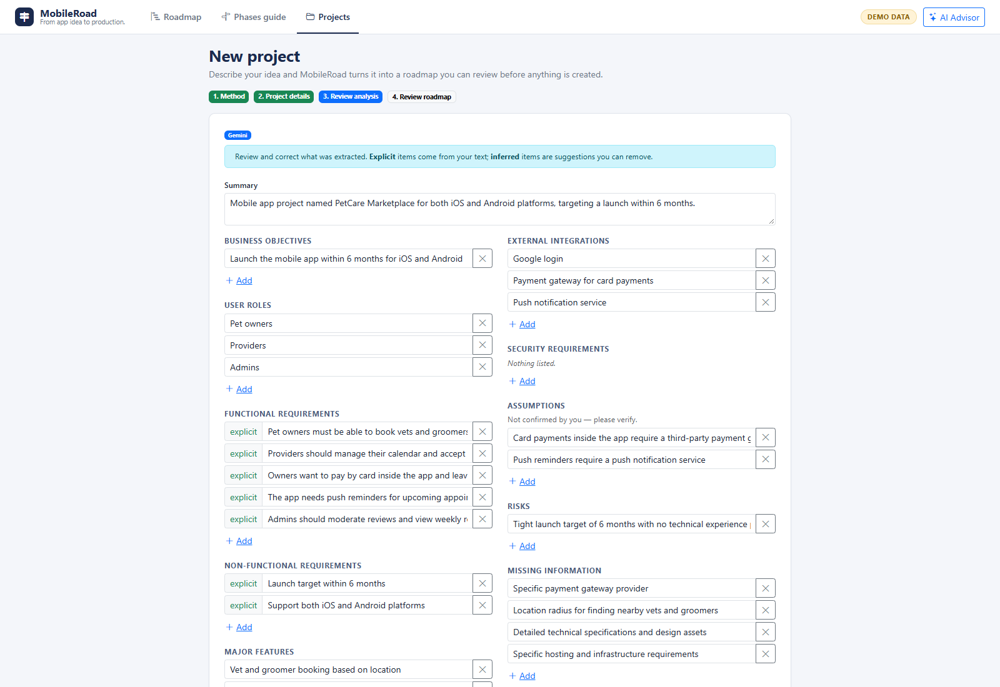</p>

### An advisor that knows your project

<table>
  <tr>
    <td width="50%">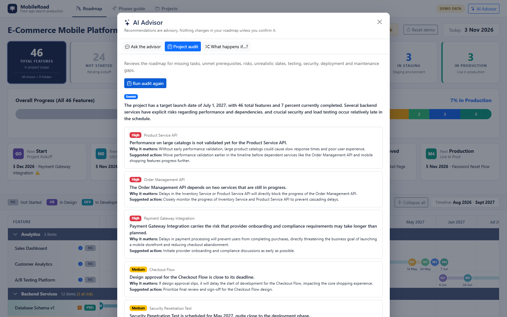</td>
    <td width="50%">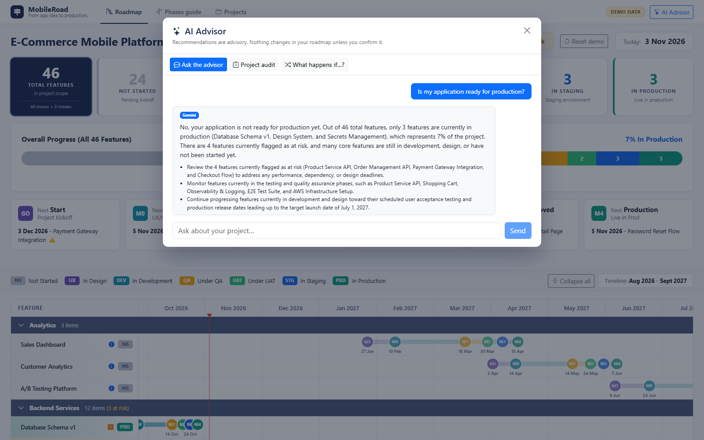</td>
  </tr>
  <tr>
    <td align="center"><b>Audit</b> — severity, why it matters, suggested action</td>
    <td align="center"><b>Advisor</b> — answers from your real data</td>
  </tr>
</table>

The third tab, **"What happens if…?"**, analyses a change such as *"The client wants real-time messaging"*:
affected features, new work, dependencies, risks and schedule impact. You pick which proposed work to add; nothing else is touched.
All AI output is validated with Zod and labelled with its source (**Gemini** or **Offline mock AI**).

### Plain-language guidance and multiple projects

<table>
  <tr>
    <td width="50%">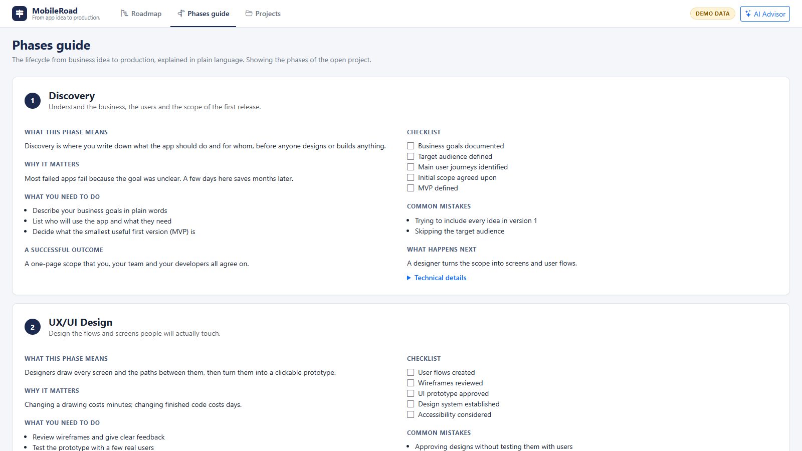</td>
    <td width="50%">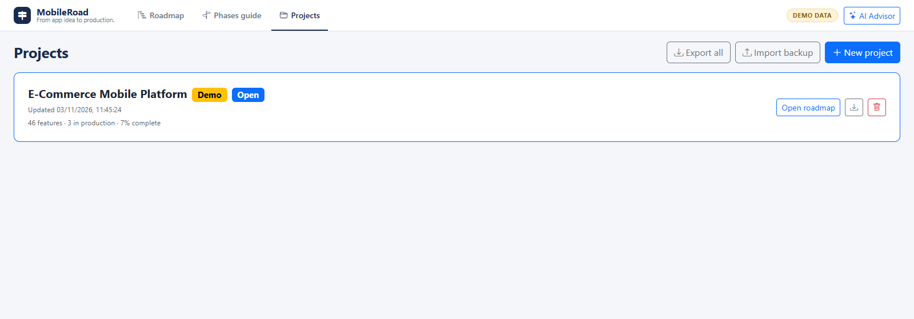</td>
  </tr>
  <tr>
    <td align="center"><b>Phases guide</b> — what it means, why it matters, what you do, common mistakes</td>
    <td align="center"><b>Projects</b> — several projects, export and import backups</td>
  </tr>
</table>

## How progress and status are modeled

Overall progress is simple and honest: **features in production ÷ total features**. It is never based on the number of phases.

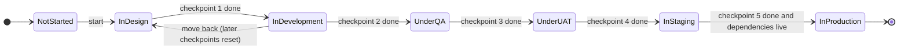

| Rule | Where it lives |
|---|---|
| A feature moves forward only when the earlier checkpoints are complete; completing a checkpoint advances it, un-completing one moves it back. | `src/domain/features.ts` |
| A feature cannot reach production while a dependency is not in production. | `src/domain/features.ts` |
| Dependencies cannot be circular or point to unknown features; dates must be valid and in order (and may be missing). | `src/domain/features.ts`, `src/domain/schemas.ts` |
| A feature is **at risk** with a medium/high risk, or when the date of its next milestone has passed. | `src/domain/roadmap.ts` |
| Milestone cards show the next upcoming date per marker across all features. | `src/domain/roadmap.ts` |

## Quick start

Requires Node.js 20 or newer.

```bash
npm install
npm run dev
```

Open <http://localhost:3000>. The app starts with a **demo project** (46 features) and works without any
API key.

## Configure Gemini (optional)

1. Create a key at <https://aistudio.google.com/apikey>.
2. Copy `.env.example` to `.env.local` and fill it in:

```bash
GEMINI_API_KEY=your-key
GEMINI_MODEL=gemini-3.5-flash-lite   # any Gemini model your key can use with generateContent
AI_TIMEOUT_MS=45000
```

3. Restart `npm run dev` (environment files are read at startup).

The key is read only on the server and never reaches the browser. If Gemini fails (bad key, unknown model,
rate limit, timeout, overload, invalid output) the answer falls back to the offline mock with a visible
warning, and your data is untouched. Transient 5xx errors are retried once.
Check which provider is active with `GET /api/ai/status` → `{"provider":"gemini"|"mock"}`.

## Your data and backups

There is no server-side database. Projects live in the browser's `localStorage`
(`mobileroad.project.<id>` per project, an index, and the active project id). Clearing site data deletes
them, so use **Projects → Export all** (or the download icon on a project) to save a
`mobileroad-backup-YYYY-MM-DD.json`, and **Import backup** to load it again.

- The file carries `app` and `version`; a file from a newer version is refused with a clear message.
- Every project is validated on import. Invalid ones are listed and skipped, never dropped silently.
- If an imported project has the same id as an existing one you choose per project:
  **keep both** (default, imported as a copy), **replace**, or **skip**.

Persistence goes through the `ProjectRepository` interface (`src/repositories`), so a real database
can replace `localStorage` without touching the domain logic.

## Deploy: GitHub and Vercel

### 1. Publish to GitHub

Create an empty repository (no README or license, they already exist here), then:

```bash
git remote add origin https://github.com/<your-user>/mobileroad.git
git push -u origin main
```

The workflow in `.github/workflows/ci.yml` runs lint, type check, tests and a production build on every push and pull request.

### 2. Deploy on Vercel

1. Go to <https://vercel.com/new> and import the GitHub repository. Next.js is detected automatically; no build settings are needed.
2. Under **Settings → Environment Variables** add `GEMINI_API_KEY`, `GEMINI_MODEL` and (optionally) `AI_TIMEOUT_MS`. Without them the deployment runs in offline mock mode.
3. Deploy. Every later push redeploys automatically.

Things to know before sharing the link:

- **The AI endpoints have no login or rate limit.** Anyone who can open your deployment can spend your Gemini key's quota. For a public demo leave `GEMINI_API_KEY` unset (mock mode), or protect the deployment with Vercel's Deployment Protection / password before adding a key.
- **Data lives in each visitor's browser, per domain.** The production URL and every preview URL have separate data; use the export / import backup to move projects between them.
- **Limits:** document uploads are capped at 4 MB (Vercel function request bodies stop at 4.5 MB) and the AI routes declare `maxDuration = 60` seconds. Your Vercel plan may impose lower function limits.
- Never commit `.env.local`; it is git-ignored. Keep secrets in Vercel's environment settings only.

## Architecture

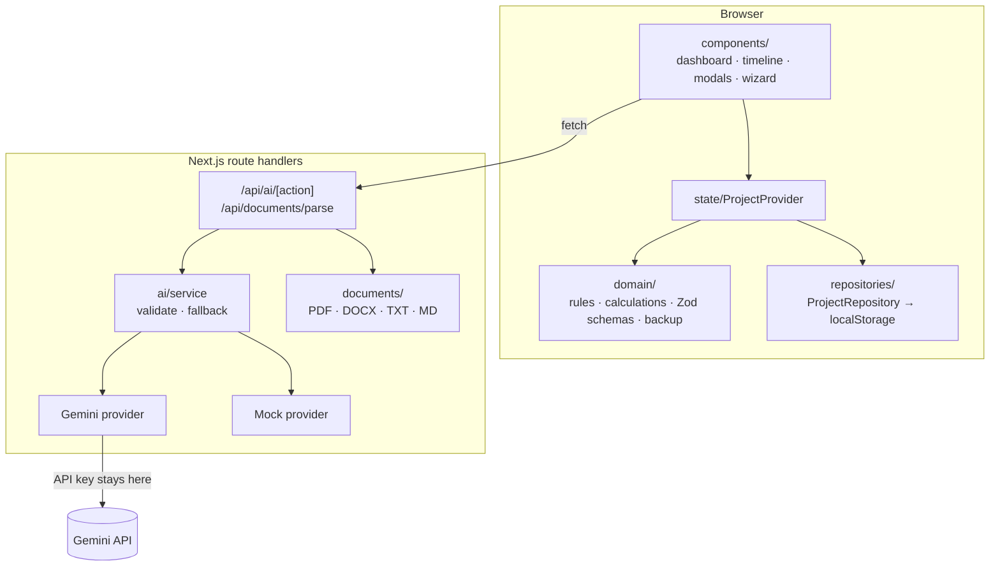

```
src/
  app/            Pages and route handlers
  components/     UI only
  domain/         Types, Zod schemas, rules, calculations, backup, project builder
  ai/             Provider interface, Gemini + mock providers, context, service with fallback
  documents/      Text extraction from PDF / DOCX / TXT / Markdown
  repositories/   Persistence boundary (localStorage implementation)
  state/          React context for the open project
  services/       Browser-side API clients
  data/           Demo project
tests/            Vitest unit tests
docs/images/      Screenshots used by this README
```

## Scripts and testing

| Command | Purpose |
|---|---|
| `npm run dev` | Development server |
| `npm run build` / `npm start` | Production build and server |
| `npm test` | Unit tests (Vitest) |
| `npm run typecheck` | TypeScript |
| `npm run lint` | ESLint |

`npm test` runs **70 deterministic tests** (fixed dates, no network): progress calculations (empty, none or
all complete, mixed, undated features), status and checkpoint rules, dependency behaviour, editing
validation, the AI layer (mock outputs, every Gemini failure mode with a fake `fetch`, retries, fallback, API
routes), document parsing with real generated PDF and DOCX files, the multi-project repository (including
migration and corrupted data), project building, and backup export / import with versioning and conflicts.

The same checks run in CI (`lint`, `typecheck`, `test`, `build`).

Manual pass: open the demo → create a project from a document → edit the analysis → generate and review
the roadmap → complete checkpoints and watch KPIs change → ask the advisor → run an audit → analyze a
scope change → read the Deployment and Support phases → export a backup, clear site data, import it again.

## Known limitations

- Single-browser storage; no accounts or sync (backups are how you move or recover data).
- Gemini output quality and speed depend on the model; the offline mock produces approximate features from documents.
- Dependencies between features are not generated for new projects; add them by editing a feature.
- Scanned (image-only) PDFs have no extractable text; paste the text instead.
- Dependency arrows are not drawn on the timeline; dependencies appear as indicators and in the feature dialog.
- Desktop is the primary target; phones and tablets scroll the timeline horizontally.

## Ideas for later

Real database and accounts, drag-to-reschedule on the timeline, dependency arrows, team members and
assignments, notifications for overdue milestones, localization.

<div align="center"><sub>Screenshots use the bundled demo project and were captured from the running app.</sub></div>
